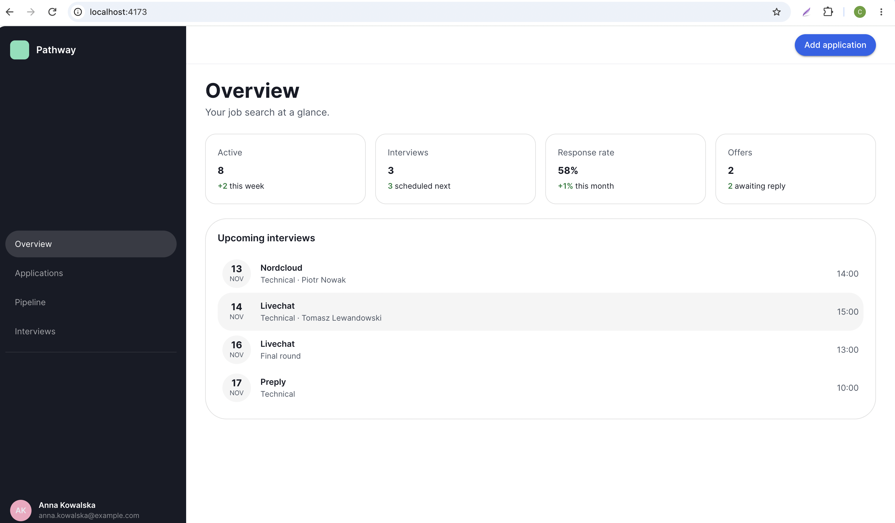
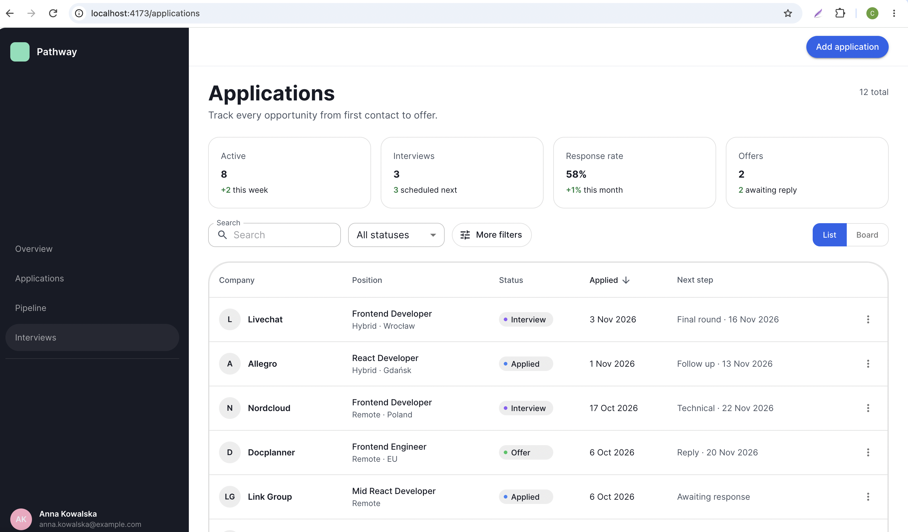
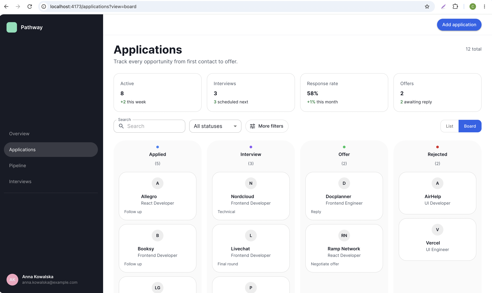
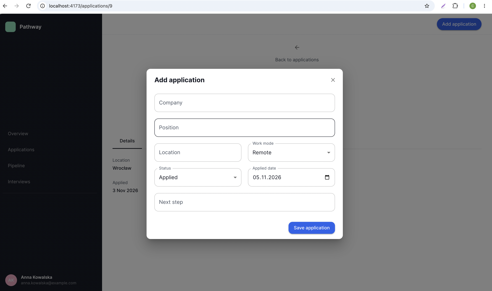
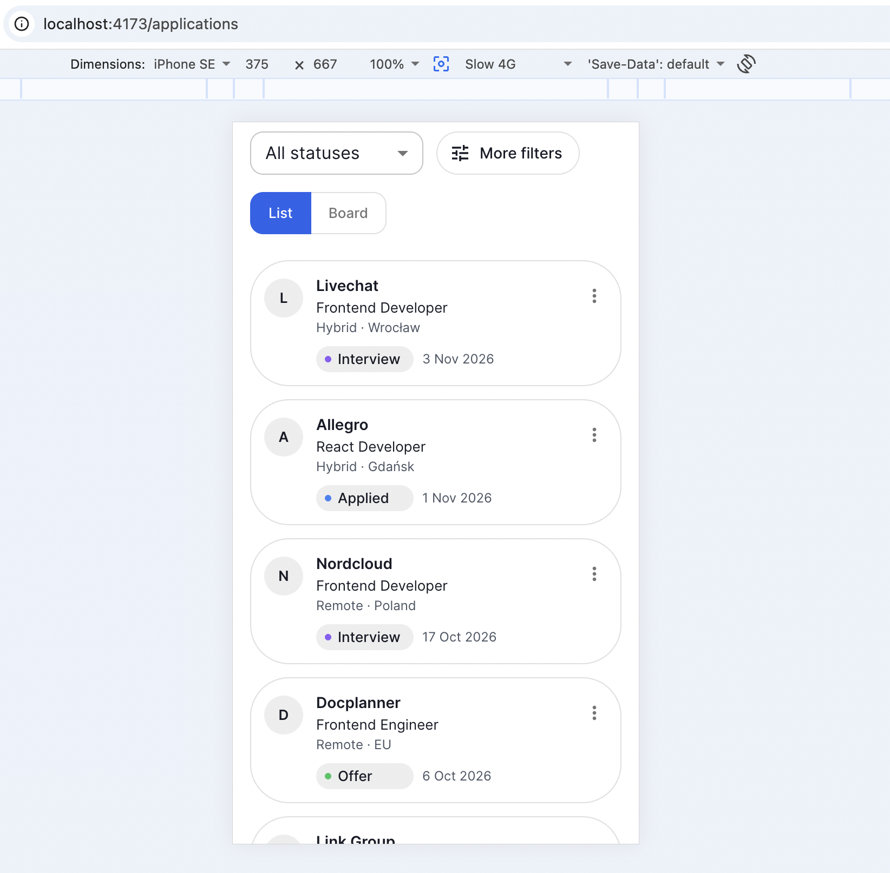
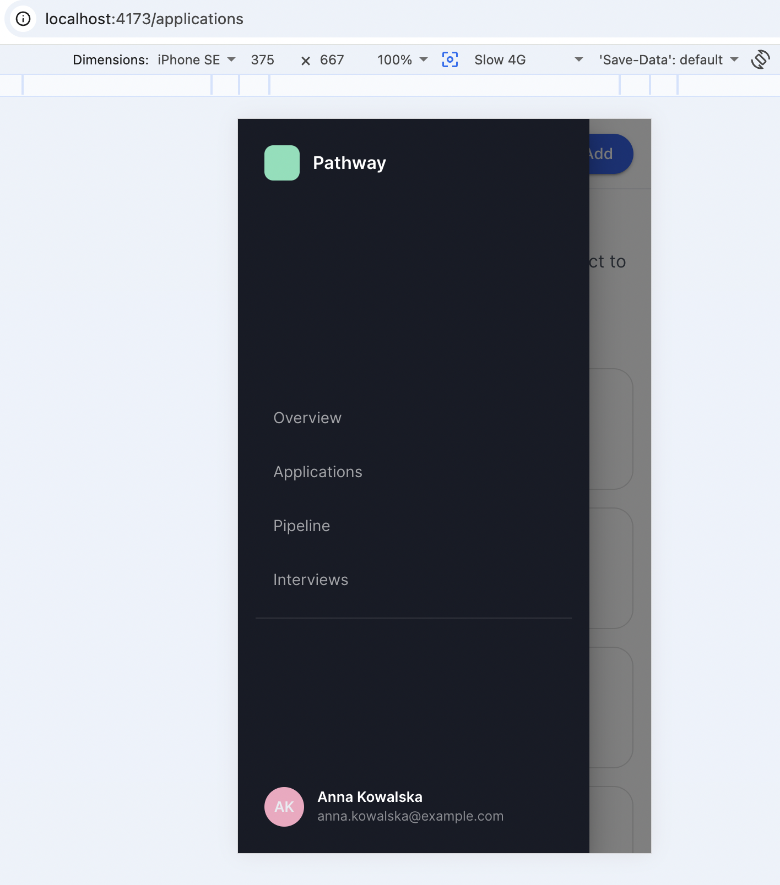

# Pathway

A job application tracker. Follow every opportunity from first contact to offer, and keep applications, contacts and interviews in one place.



## Features

- **Overview**: KPI cards (active, interviews, response rate, offers) and the next upcoming interviews
- **Applications**: list with debounced search, status filter, sorting and pagination. Filters live in the URL, so links are shareable and survive a refresh
- **Pipeline board**: Applied / Interview / Offer / Rejected columns with drag and drop. Status changes are applied optimistically and rolled back if the server rejects them
- **Application details**: tabs for details, contacts, interviews and an activity timeline
- **Create, edit, delete**: one dialog for create and edit, Zod validation on the client, server validation errors shown under the fields
- **Resilient UI**: loading skeletons, empty states, error states with retry, error boundaries at app, page and widget level
- **Responsive**: drawer navigation and a card list on small screens, fixed sidebar and a table on desktop
- **Accessibility**: labelled controls, keyboard-friendly dialogs and menus, a skip link

## Screenshots

| Applications                                                 | Board                                                      |
| ------------------------------------------------------------ | ---------------------------------------------------------- |
|  |  |

| Application details                                              | Add application                                                 |
| ---------------------------------------------------------------- | --------------------------------------------------------------- |
|  |  |

| Mobile list                                      | Mobile navigation                                      |
| ------------------------------------------------ | ------------------------------------------------------ |
|  |  |

## Tech stack

- React 19, TypeScript, Vite
- MUI (Material UI) for components and theming
- TanStack Query for server state
- React Router for routing; filters, sorting, pagination and view mode are stored in the URL
- React Hook Form and Zod for forms and validation
- dnd-kit for drag and drop
- Express for the mock API (in-memory data)
- Vitest, React Testing Library and MSW for tests

## Getting started

Requirements: Node.js 20.19 or newer and Yarn 1 (classic).

```bash
yarn install
```

Run the API and the client in two terminals:

```bash
yarn api   # mock API on http://localhost:5010
yarn dev   # client on http://localhost:5173
```

### Scripts

| Script          | Description                                         |
| --------------- | --------------------------------------------------- |
| `yarn dev`      | Start the client with hot reload                    |
| `yarn api`      | Start the mock API (restarts on file changes)       |
| `yarn build`    | Type-check and build the client into `dist/`        |
| `yarn preview`  | Serve the production build on http://localhost:4173 |
| `yarn lint`     | Run ESLint                                          |
| `yarn test`     | Run tests in watch mode                             |
| `yarn test:run` | Run tests once                                      |

### Configuration

| Variable       | Default                 | Description                             |
| -------------- | ----------------------- | --------------------------------------- |
| `VITE_API_URL` | `http://localhost:5010` | Base URL of the API. Read at build time |

Copy `.env.example` to `.env.local` to override it. An empty value makes the client call the same origin, which is useful behind a reverse proxy.

## Production build

```bash
yarn build     # type-check and bundle into dist/
yarn preview   # serve dist/ locally
```

- `VITE_API_URL` is inlined at build time. Rebuild after changing it.
- The app uses client-side routing. A static host must serve `index.html` for unknown paths (SPA fallback). `yarn preview` does this already; on Netlify, Vercel or Nginx add a rewrite rule.
- The client needs a running API. The mock API is a Node process and is not part of the static bundle.

## Project structure

```
.
├── docs/screenshots/        # images used in this README
├── mock-api/
│   ├── index.js             # Express app: routes, validation, filtering
│   └── responses/           # seed data (applications, contacts, interviews)
└── src/
    ├── api/                 # apiClient (fetch wrapper, ApiError) and request functions
    ├── components/
    │   ├── details/         # tabs, dialogs and forms of the application details page
    │   ├── errors/          # error states and error boundary fallbacks
    │   └── form/            # form layout helpers
    ├── constants/
    ├── hooks/               # React Query hooks and mutations
    ├── lib/                 # QueryClient configuration
    ├── pages/               # Overview, Applications, ApplicationDetails, Pipeline, ...
    ├── schemas/             # Zod schemas
    ├── test/                # test setup, MSW handlers and in-memory test data
    ├── types/
    ├── utils/
    ├── a11y.ts              # shared accessibility helpers
    ├── layout.ts            # shared spacing and layout constants
    ├── theme.ts             # MUI theme
    ├── App.tsx              # app shell: sidebar, top bar, dialog, error boundary
    ├── AppRoutes.tsx
    └── main.tsx             # providers and entry point
```

## Architecture

**Data flow.** A page calls a hook, the hook calls React Query, and React Query calls a request function that goes through `apiClient` to the API:

```
page → hook (useQuery / useMutation) → api function → apiClient (fetch) → Express
```

**State.**

- _Server state_ (applications, contacts, interviews, stats) lives in the React Query cache. Keys form a hierarchy: `['applications', params]`, `['applications', id]`, `['applications', id, 'contacts']`, `['dashboard', 'stats']`, `['interviews', 'upcoming']`.
- _View state_ that should be shareable (search, status, sort, page, view mode) lives in the URL.
- _Local UI state_ (open dialogs, menus, form values) stays in components.

**Mutations.** Create, update and delete invalidate `applications` and `dashboard/stats`. Moving a card on the board is optimistic: the cache is updated immediately and restored if the request fails.

## Mock API

Base URL: `http://localhost:5010`

- Data lives in memory and **resets whenever the server restarts**.
- Interview dates are generated relative to the start time, so "upcoming" is never empty.
- CORS is open for all origins.

### Endpoints

| Method | Path                                            | Description                                                   |
| ------ | ----------------------------------------------- | ------------------------------------------------------------- |
| GET    | `/api/health`                                   | Health check                                                  |
| GET    | `/api/applications`                             | List with filtering, sorting and pagination                   |
| GET    | `/api/applications/:id`                         | One application                                               |
| POST   | `/api/applications`                             | Create an application                                         |
| PATCH  | `/api/applications/:id`                         | Update an application                                         |
| DELETE | `/api/applications/:id`                         | Delete an application                                         |
| GET    | `/api/applications/:id/contacts`                | Contacts of an application                                    |
| POST   | `/api/applications/:id/contacts`                | Add a contact                                                 |
| PATCH  | `/api/applications/:id/contacts/:contactId`     | Update a contact                                              |
| GET    | `/api/applications/:id/interviews`              | Interviews of an application                                  |
| POST   | `/api/applications/:id/interviews`              | Add an interview                                              |
| PATCH  | `/api/applications/:id/interviews/:interviewId` | Update an interview                                           |
| GET    | `/api/interviews`                               | Interviews across all applications, with company and position |
| GET    | `/api/dashboard/stats`                          | KPI values for the overview                                   |

### List parameters

`GET /api/applications` and `GET /api/interviews` accept query parameters:

| Parameter       | Applies to   | Description                                                        |
| --------------- | ------------ | ------------------------------------------------------------------ |
| `search`        | applications | Case-insensitive match on company or position                      |
| `status`        | applications | `applied`, `interview`, `offer`, `rejected` or `all`               |
| `sort`          | applications | `field:direction`, for example `appliedAt:desc`                    |
| `page`, `limit` | applications | 1-based page and page size. Without `limit` everything is returned |
| `upcoming`      | interviews   | `true` returns scheduled interviews in the future, soonest first   |
| `limit`         | interviews   | Maximum number of items                                            |

The applications list responds with `{ "items": [...], "total": 12 }`. `total` is the number of matches before pagination.

### Statistics

```json
{
  "active": 8,
  "interviews": 3,
  "responseRate": 58,
  "offers": 2,
  "addedThisWeek": 2,
  "interviewsScheduledNext": 3,
  "offersAwaitingReply": 2,
  "responseRateDelta": +1
}
```

- `active`: applications with status `applied` or `interview`
- `responseRate`: share of applications that reached `interview`, `offer` or `rejected`, in percent
- `responseRateDelta`: difference in percentage points between the current rate and the rate among applications older than one month

### Validation and errors

Required fields: for applications `company`, `position`, `location`, `workMode`, `status`, `appliedAt`; for contacts `name`, `role`; for interviews `type`, `scheduledAt` (`status` defaults to `scheduled`).

| Status | When                                      | Body                                                                               |
| ------ | ----------------------------------------- | ---------------------------------------------------------------------------------- |
| 400    | A required field is missing               | `{ "error": "Validation failed", "fields": { "company": "company is required" } }` |
| 404    | Unknown application, contact or interview | `{ "error": "Application not found" }`                                             |

### Examples

```bash
# Interviews of applications, newest first, first page
curl "http://localhost:5010/api/applications?status=interview&sort=appliedAt:desc&page=1&limit=5"

# Create an application
curl -X POST http://localhost:5010/api/applications \
  -H "Content-Type: application/json" \
  -d '{"company":"Acme","position":"Frontend Developer","location":"Remote","workMode":"remote","status":"applied","appliedAt":"2026-11-04"}'
```

### Data model

```ts
type ApplicationStatus = "applied" | "interview" | "offer" | "rejected";

interface Application {
  id: string;
  company: string;
  position: string;
  location: string;
  workMode: "remote" | "hybrid" | "onsite";
  status: ApplicationStatus;
  appliedAt: string; // YYYY-MM-DD
  nextStep?: string;
  nextStepDate?: string;
}

interface Contact {
  id: string;
  applicationId: string;
  name: string;
  role: string;
  email?: string;
  phone?: string;
  linkedinUrl?: string;
}

interface Interview {
  id: string;
  applicationId: string;
  type: "phone" | "technical" | "onsite" | "final";
  scheduledAt: string; // local date and time, ISO without timezone
  status: "scheduled" | "completed" | "cancelled";
  interviewerName?: string;
  notes?: string;
}
```

Contacts and interviews reference their application through `applicationId`.

## Testing

```bash
yarn test       # watch mode
yarn test:run   # single run
```

Integration tests render the whole app with Testing Library and replace the network with MSW handlers. The handlers in `src/test/handlers.ts` mirror the mock API contract, so update them when the API changes.

## Known limitations

- No authentication; the user in the sidebar is hard-coded
- Data is not persisted between API restarts
- Contacts and interviews can be created and edited, but not deleted
- The Interviews page is a placeholder
- The "More filters" button is not wired up yet
